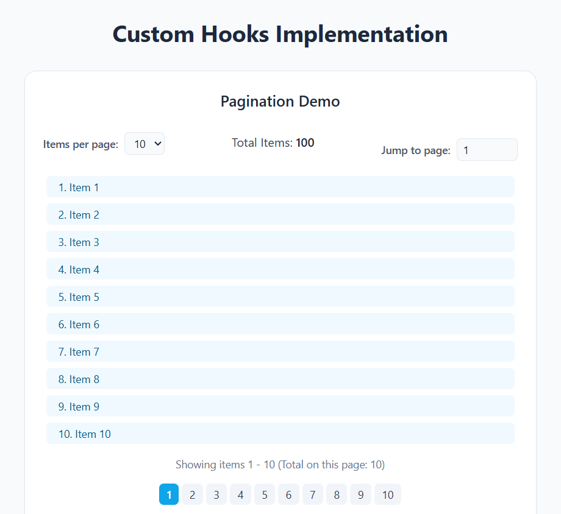
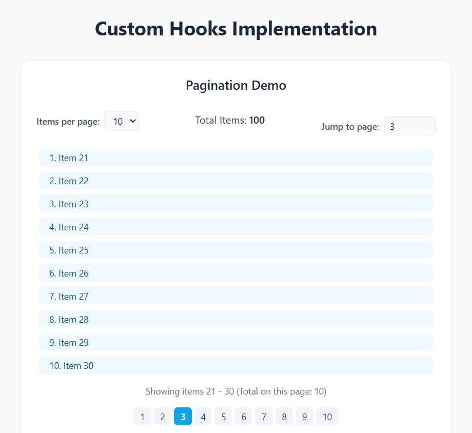
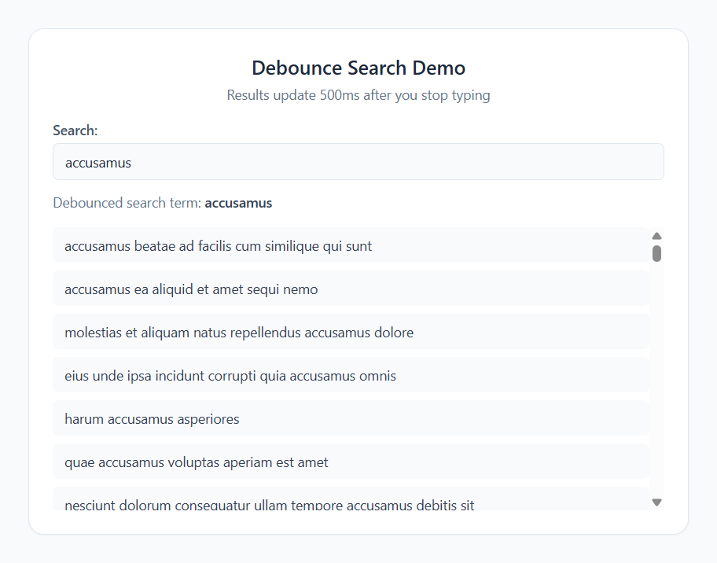

# Custom Hooks

Two demos on one page. One splits a list into pages. The other waits until you stop typing, then searches photo titles.

## Description

`usePagination` keeps the current page for a list of 100 items.

* Items per page can be 5, 10, 20, or 50. It starts at 10.
* Each page has a numbered button. Previous and Next sit under those buttons, with a “Page X of Y” label between them.
* Previous is unavailable on the first page. Next is unavailable on the last page.
* The jump field sets the page directly. A number outside the range is ignored.
* The line under the items says which range is on screen, such as “Showing items 1 - 10”.

`useDebounce` holds the latest text for 500ms. The demo prints both the text in the box and the debounced value. Before a search, the debounced value is an em dash.

After the pause, the page downloads the photo list from [JSONPlaceholder](https://jsonplaceholder.typicode.com/photos) and keeps titles that include the search text.

* While the request is in flight, the page says “Searching...”
* A search with no matches says “No matching titles.”
* A failed request says “Could not load search results.”
* Clearing the box clears the list
* Starting a new search cancels the request that is still in flight

## Screenshots

### Pagination

The list starts on page 1, with 10 items per page and 100 items in total.



### Another page

Choosing page 3 shows items 21–30. The selected page is highlighted, and the jump field shows 3.



### Debounced search

The search waits 500ms after the last keystroke, then lists photo titles that contain the word. This search is for `accusamus`. The list scrolls when there are more titles than fit.



## Getting Started

### Dependencies

* Node.js and npm
* A network connection for the photo titles
* React 19, TypeScript, Vite, and Tailwind CSS

### Installing

```bash
npm install
```

### Executing program

```bash
npm run dev
```

Open the URL Vite prints, usually `http://localhost:5173/`.

| Command | What it does |
| --- | --- |
| `npm run build` | Type-check and build for production |
| `npm run preview` | Serve the production build |
| `npm run lint` | Run ESLint |

## Help

A jump number outside the page range is ignored. A search with no matches says “No matching titles.” A failed request says “Could not load search results.” The search waits 500ms after the last keystroke.

## Authors

[Mamadou Moussa Balde](https://www.linkedin.com/in/2mb/)

## Version History

* Current local run
    * Vite, usually `http://localhost:5173/`
    * Page 1, page 3, and a search for `accusamus` were captured

## License

This folder does not include a `LICENSE.md` file.

## Acknowledgments

* [JSONPlaceholder](https://jsonplaceholder.typicode.com/photos)
* [React](https://react.dev/)
* [Vite](https://vite.dev/)
* [Tailwind CSS](https://tailwindcss.com/)
* [README template](https://gist.github.com/DomPizzie/7a5ff55ffa9081f2de27c315f5018afc)
